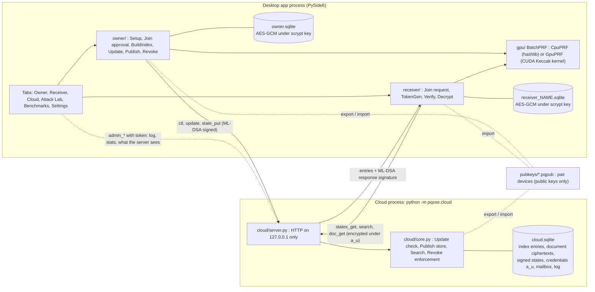
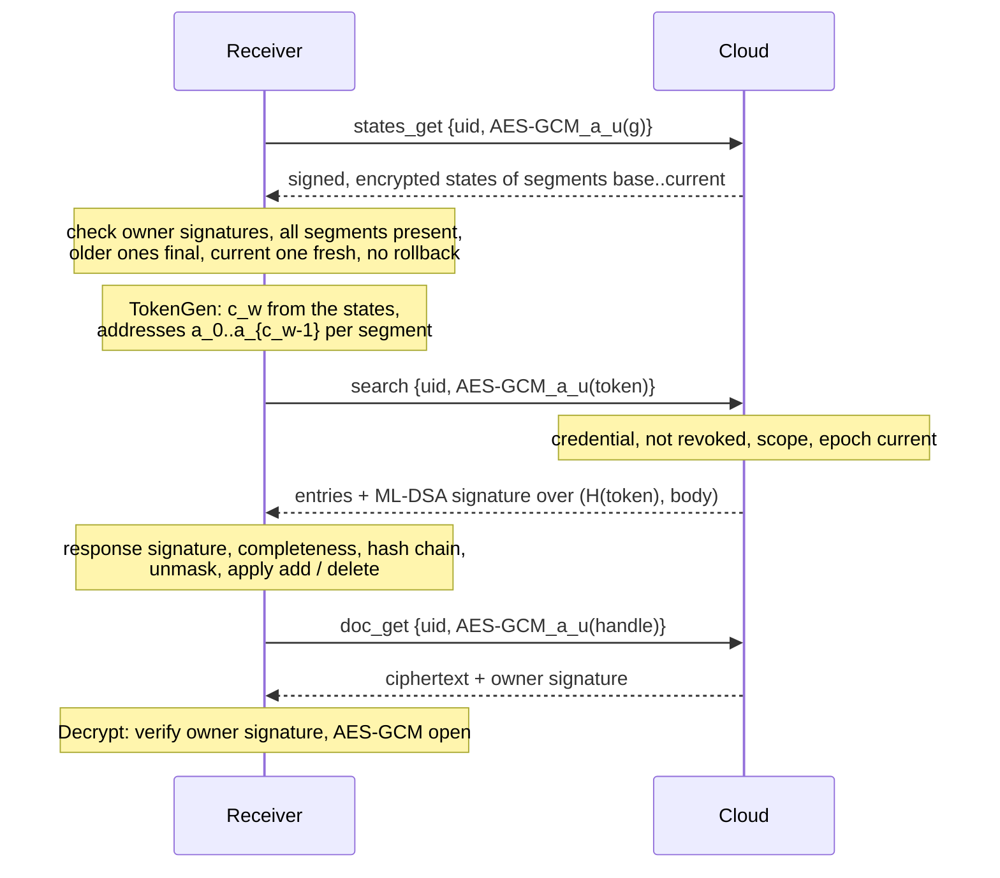

# Architecture

Three parties with no shared in-memory state. Owner and receivers run inside the desktop
app; the cloud is its own process and is reached only through HTTP on 127.0.0.1.
Every message is a `pqsse.core.wire` encoded value.

## Who holds what

| Secret | Owner | Receiver u | Cloud |
| --- | --- | --- | --- |
| Owner ML-DSA signing key | yes | no | no |
| Group keys `K_g^e` and derived `K_idx`, `K_doc`, `K_st` | yes | only groups in its capability | never |
| Receiver ML-KEM and ML-DSA secret keys | no | yes | no |
| Credential `a_u` | yes | yes | yes (wrapped under the cloud passphrase key) |
| Rekey key `m_u` | yes | yes | no |
| Cloud ML-KEM and ML-DSA secret keys | no | no | yes |
| Keywords, document text | yes | after Verify and Decrypt | never |

## Where the GPU is used

Only inside `BatchPRF`:

- `hmac_fixed` / `hmac_many`: the PRF `F = HMAC-SHA3-256` for addresses and masks
  (BuildIndex, Update, and TokenGen for long result lists).
- `sha3_fixed`: one hash chain "level" across many keywords at a time (BuildIndex, Update).

ML-KEM, ML-DSA, AES-GCM, HKDF, scrypt and everything in the cloud run on the CPU.
The GPU path is enabled only after its output matched `hashlib` and `hmac` byte for byte.

## Search, step by step

